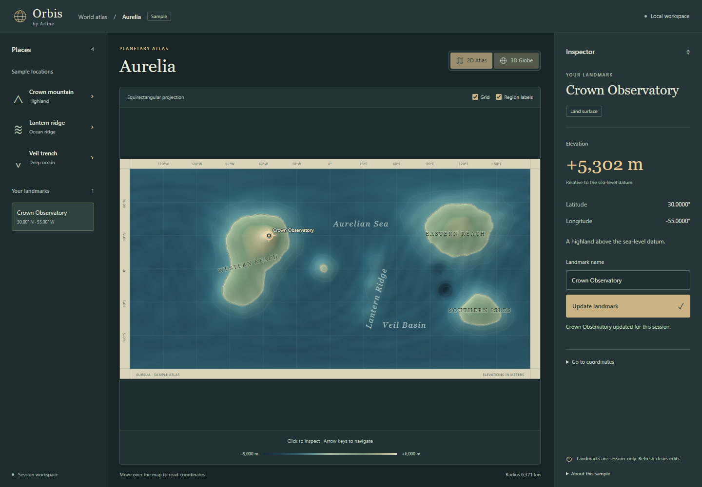
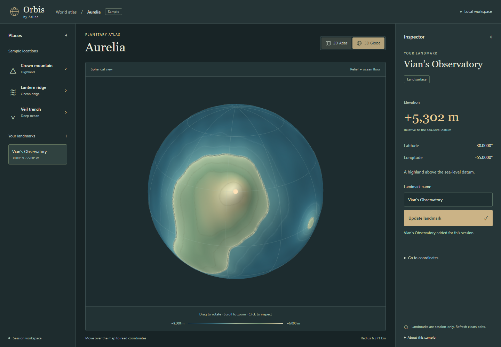
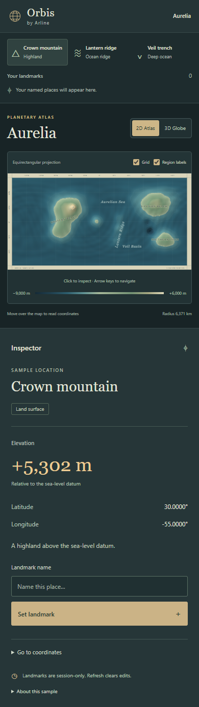

# M0 — Foundation and clickable prototype

Implemented by Opheline; locally verified on **2026-10-11**, before M1 implementation. No Arline Studio files or databases are involved.

This report preserves the original M0 scope and historical evidence. **M1 is now implemented**; [M1](M1.md) supersedes the session-only editing and missing persistence/geometry features described below.

## Available behavior

- Svelte 5 / TypeScript / Vite application with a responsive atlas and inspector.
- Original `aurelia-001` seeded sample, algorithm `m0-sample-v1`: visible continents/coasts, Crown mountain **+5,302 m**, Lantern ridge **−923 m**, Veil trench **−7,511 m**.
- 720 × 361 signed 16-bit elevation raster, **519,840 bytes**. Both views consume the same raster and color texture.
- Equirectangular Canvas-derived raster with D3 graticule and SVG geographic markers. Pointer readout, click selection, arrow navigation (Shift = 10°) and exact coordinate input.
- Lazy Three.js globe: drag rotation, wheel zoom, surface raycasting, authored-marker picking, selection centering and the same elevation readout as the atlas.
- Name and rename session landmarks with stable IDs. Switch views or select a landmark from the list without changing its geographic anchor.
- Graceful return to 2D when WebGL initialization fails or its context is lost. Existing session landmarks survive the fallback.
- No external service, account, font, image or terrain download at runtime. All visual assets are generated locally from original code.

## Deliberate boundaries

**Landmarks are in memory only. Refresh clears edits.** The inspector displays this limitation. IndexedDB, save/load, versioned imports/exports, locks, recovery history, distance measurement, editable radius and separate water-depth state are M1 work. This prototype is not suitable for storing irreplaceable authored work yet.

The sample uses spherical Gaussian terrain shapes and seeded continuous noise; it is not scientific geology. Terrain and negative seafloor elevation share a datum, but there is no separate water surface/visibility control or cave-depth model in M0. Sample-site names are navigation shortcuts, not authored landmarks.

The coarse fixture is generated once at startup on the main thread, never on drag or pointer movement. Workers become necessary for larger/cancellable generators; M0 does not create empty pipeline abstractions. The globe uses a 96 × 64 sphere mesh and caps rendering pixel ratio at 2. It renders on interaction/resize/selection, with no perpetual idle animation loop. SVG atlas navigation is selection-based; 2D pan/zoom is not implemented.

The production build requires a local HTTP server (`npm run preview`) or static hosting. It does not provide a service-worker installation or `file://` support. Initial dependency/browser installation requires internet; the installed local app needs no internet or remote services.

## Reference-inspired visual refinement

The visual pass takes ideas from the existing references: [Azgaar](https://azgaar.github.io/Fantasy-Map-Generator/) for prominent cartographic labels and coastal bands, [Mapgen4](https://www.redblobgames.com/maps/mapgen4/) for legible relief and terrain outlines, and [Nortantis](https://github.com/jeheydorn/nortantis) for a traditional atlas feel. Reference code and assets were not copied; no new dependencies were added.

The atlas has a coordinate frame, a quieter 30-degree graticule, muted sage land colors, northwest relief shading, coastline strokes and raster-derived elevation/bathymetric isolines. The globe consumes the same refined texture and has a display-only geographic graticule. The compact map toolbar provides working grid and region-label toggles. Following the supplied reference screenshots, the inspector now uses charcoal/teal panels, brass accents, serif place names, monospaced captions and a prominent signed elevation readout. The legend matches the terrain color stops.

Region names are fictional sample annotations only, not authored features. Toggling them never hides authored landmark labels. Elevation values, generation seed/version and geographic positions are unchanged. Mobile keeps the map's actual aspect ratio rather than reserving tall empty space. Automated browser coverage includes display toggles with an authored anchor present; both phone and desktop screenshots were visually inspected.

The subsequent workspace polish uses three connected desktop columns: a compact Places list, the central atlas, and a focused inspector. System typography keeps controls readable, while serif place names and brass elevation values retain the atlas character. The inspector presents one elevation reading and one coordinate pair; exact coordinate entry is available under **Go to coordinates**. Sample details are disclosed under **About this sample**. Tablet and phone layouts rearrange the same controls without horizontal overflow. No terrain, coordinate or landmark behavior changed during this pass.

## Source recovery

The restored checkout was missing the untracked M0 application source, configurations, tests and lockfile while retaining the production build and installed dependencies. Git commit `initial engine` contained only `.gitignore`; Git did not contain the missing implementation. The source patches were reconstructed from this chat's local session log, then revalidated and styled against the supplied atlas screenshots. The regenerated lockfile resolves the installed dependency baseline. The cause of the file removal is unconfirmed.

`.gitignore` keeps dependencies, build output and generated test evidence out of Git, while `src/`, package manifests, the lockfile, tests and chosen documentation screenshots remain eligible for version control. Recovered source has not been committed or pushed in this restoration turn.

## Reproduce

Node.js 22.12+ and npm are required. Use the committed lockfile:

```sh
npm ci
npm run dev
npm run check
npm test
npm run build
npm run preview
npx playwright install chromium
npm run test:e2e
```

Playwright starts a local dev server on port 4173 by default. To exercise the production build in PowerShell:

```powershell
npm run build
$env:ORBIS_E2E_PREVIEW = '1'
npm run test:e2e
Remove-Item Env:ORBIS_E2E_PREVIEW
```

Do not leave a dev server occupying port 4173 when testing production: Playwright may reuse an existing server locally. CI always starts its own production preview. The checked-in CI workflow performs typecheck, unit tests, build and production browser tests; CI itself has not been run remotely in this implementation session.

## Demo checklist

1. Open the sample. Click **Crown mountain**; confirm 30° N, 55° W and positive elevation.
2. Enter a landmark name and choose **Set landmark**. Switch to **3D Globe**; the marker is centered, at the same coordinates and elevation.
3. Drag to rotate. Drag release must not select a different position. Click the globe to inspect a new position; choose the named landmark from Places to return.
4. Switch back to **2D Atlas**; rename the landmark with **Update landmark**. The map and list both update.
5. Visit **Lantern ridge** and **Veil trench**; both are below datum and the trench is deeper.
6. Open **Go to coordinates** and enter latitude `90` / longitude `180`. Confirm longitude wraps to `−180`; arrow keys wrap longitude and clamp latitude at the poles.
7. Resize to a narrow phone viewport. Controls and inspector stack without horizontal overflow.
8. Refresh; the sample loads without an exception and session landmarks clear as stated. Automated tests also force WebGL unavailability and graphics-context loss.

## Validation evidence

- `npm run check`: **0 errors, 0 warnings** (Svelte and TypeScript).
- `npm test`: **14 tests pass**. Numeric validation, UV/vector round trips, actual Three SphereGeometry UV orientation, dateline/poles, deterministic seeds, signed terrain fixtures, raster interpolation, landmark identity/copy behavior.
- `npm run test:e2e`: **4 production browser tests pass**. Landmark naming/renaming, shared anchors, real globe raycast/drag, refresh, pointer/keyboard input, WebGL failure, context loss, mobile overflow and no external network requests. The first three scenarios also passed against the dev server before adding the context-loss scenario.
- `npm run build`: passes. Vite reports a **542.87 kB** lazy globe chunk (**135.70 kB gzip**), above its 500 kB advisory threshold. After workspace polish, the initial app chunk is **82.12 kB** (**32.01 kB gzip**); 2D does not load the globe chunk. This warning is retained; no threshold is hidden.
- `npm install`: audit reported **0 vulnerabilities** at implementation time.
- Running 2D, globe and mobile screenshots below were rendered by Playwright and visually inspected.

The workspace polish was rechecked with Svelte/TypeScript checking, a production build and all four production browser tests. The domain unit suite above was run during restoration; domain code did not change in the UI pass.





The earlier visual-refinement captures recovered from local test output remain available: [atlas](screenshots/atlas-refined.png), [globe](screenshots/globe-refined.png), [mobile](screenshots/mobile-refined.png).

## Local performance snapshot

One production-preview sample after source restoration and styling, before the subsequent workspace polish, on Windows, AMD Ryzen 9 7950X, approximately 63.1 GiB system RAM, Chromium **156.0.8078.4**, 1440 × 1000 viewport, device pixel ratio 1, **ANGLE SwiftShader software WebGL** (not hardware GPU). The fixture uses the detail settings specified above.

| Measurement | Result |
| --- | ---: |
| Initial coarse generation | 509.0 ms |
| Atlas JS heap used (CDP) | 3.82 MiB |
| Globe JS heap used (CDP) | 7.73 MiB |
| First globe click to two animation frames after canvas availability | 132.89 ms |
| Selection to two animation frames, 20 samples | median 33.4 ms / p95 34.1 ms |
| Globe drag animation-frame intervals, 39 samples | median 16.7 ms / p95 16.8 ms |

JS heap excludes native browser/GPU allocations and is not total application memory. Animation-frame intervals are a synthetic scheduling/interaction snapshot, not an FPS guarantee or a rendering throughput benchmark. Globe-ready time includes automation overhead and is measured with the local server available. Low-end hardware, Firefox/Safari and real hardware GPU behavior have not been validated.

To repeat against a running preview on port 4173:

```sh
node scripts/benchmark.mjs
```

Optionally set `ORBIS_BENCH_URL` to another local server URL. Results vary by machine and browser.

## Dependency and licensing decisions

The architecture's proposed stack was retained. Runtime packages resolved locally: Svelte 5.57.2 (MIT), Three.js 0.185.1 (MIT), D3-geo 3.1.1 (ISC). Tooling: Vite 8.3.4 (MIT), Svelte Vite plugin 7.3.1 (MIT), Vitest 5.0.3 (MIT), Playwright 1.64.0 (Apache-2.0). Exact dependency versions and transitive packages are in `package-lock.json`; upstream notices remain in installed packages. The project itself still has **no selected software license**. No reference-project code or external geographic dataset was copied.

Coordinate transforms and terrain are independent of rendering. The Three sphere UV convention is checked against the actual dependency's geometry, rather than only testing an inverse transform against itself. Globe interaction follows the official [OrbitControls](https://threejs.org/docs/pages/OrbitControls.html) and [Raycaster](https://threejs.org/docs/pages/Raycaster.html) APIs; Svelte checking follows its [TypeScript documentation](https://svelte.dev/docs/svelte/typescript).

## Next milestone

M1 should introduce author-safe persistence, recovery and portable versioned export before encouraging long-lived world editing, then radius/geodesic tools and explicit water-depth/visibility semantics. Review this prototype's usability first. No push, PR or deployment was performed as part of M0 implementation.
