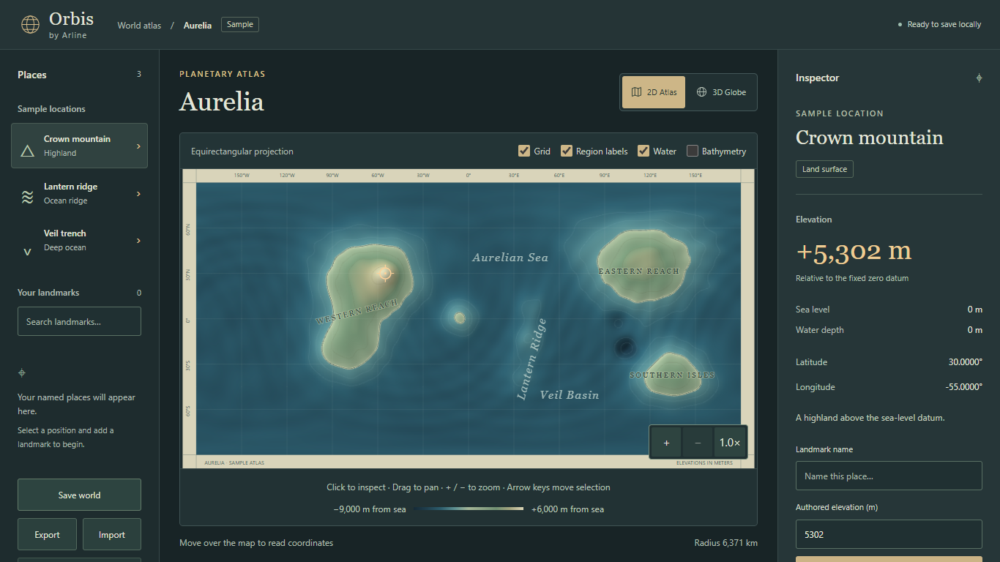
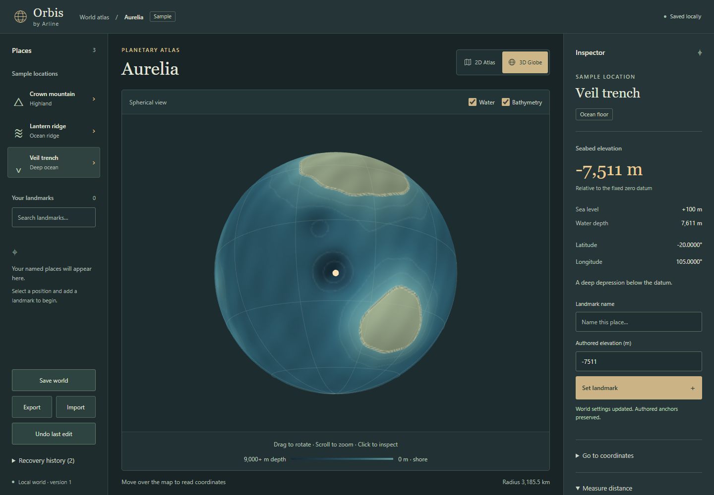
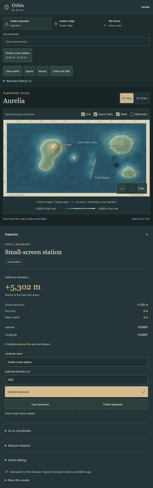

# M1 — Reliable local atlas editing

Implemented by Opheline and locally verified on **2026-10-12**. This builds on M0 and the refined atlas workspace. M2 remains planned.

## Available behavior

- IndexedDB autosave and explicit **Save world**. Refresh restores the current project, selection, authored landmarks and unfinished drafts.
- JSON **Export** and **Import** preserve stable landmark IDs, coordinates, authored elevations, locks, seed, algorithm version, radius, sea level and optional metadata. Invalid imports leave the active world unchanged.
- Thirty previous edit snapshots and thirty recovery backups, including a forward backup before undo. Import, deletion, movement, lock changes and settings changes are recoverable. Recovery survives reload.
- Synchronous emergency journals retain changes while an asynchronous save is pending. Same-tab recovery reopens compatible unfinished work; other journals are offered in Recovery history. Storage denial or save conflicts are shown explicitly, and export remains available.
- Transactional revision checks reject stale saves from another tab instead of silently overwriting the newer world.
- Landmark names and authored elevations can be changed; coordinates can be moved explicitly. Locked landmarks must be unlocked before editing, moving or deleting. Regenerating the sample seed never overwrites authored anchors, whether locked or unlocked.
- Draft names stay attached to their coordinates when changing selection. Drafts can be revisited from Places, saved or discarded. Landmark search and deletion with undo are available.
- Radius editing in kilometers, stored in meters. The distance tool measures shortest spherical great-circle distance in kilometers, including seams and poles.
- Sea level remains separate from the fixed elevation datum. Water depth is `max(0, sea_level_m - sampled_terrain_elevation_m)`. It does not use authored marker altitude or represent cave depth.
- Water coloring can be hidden to expose seafloor relief. Bathymetry emphasizes submerged depth, mutes dry land and uses depth contours. Both views update from the same display texture without changing the elevation raster.
- Atlas zoom controls, keyboard zoom and drag-to-pan. A drag does not select a different position. Both atlas and globe accept arrow-key selection; the globe also accepts keyboard zoom.
- The brand no longer reloads the workspace. Larger captions and at least 44px primary/list/mode buttons improve readability and touch use. Short laptop screens keep the panels scrollable; narrow layouts stack the same tools.

## Portable project contract

The implemented small-world format is `format: "orbis-project", version: 1`. It is distinct from the aspirational package manifest in [DATA_MODEL.md](DATA_MODEL.md). It contains `planet`, `landmarks`, `drafts` and `selection`.

The fixed `m0-sample-v1` recipe plus seed reconstructs the complete 720 × 361 raster; the JSON does not contain a giant elevation array. This release rejects unknown generator versions rather than reconstructing a different world. Future binary/tile formats need an explicit migration.

Imports are limited to **2 MB**, **1,000 landmarks** and **1,000 drafts**. They validate finite values, geographic bounds, IDs, duplicate anchors, text lengths, ownership, locks and generator/schema versions. Longitude 180 normalizes to −180. Radius is bounded to 1–1,000,000 km; elevation and sea level to −20,000–20,000 m.

Version 0 of this specific Orbis JSON format migrates missing locks to `false`, retains its original payload in `migration_source`, and exports as version 1. The proposed package-manifest version 0 is not treated as this format. Unknown optional project, planet and landmark metadata survives validation and round-trip.

## Validation

- Svelte/TypeScript checking: **0 errors, 0 warnings**.
- Unit suite: **26 tests pass**, including format round-trip/migration/rejection, depth semantics and scaled seam/pole distances, alongside M0 coordinate and terrain checks.
- Production Chromium suite: **12 tests pass**, including refresh persistence, drafts, locks, regeneration preserving authored elevation, movement, deletion/undo, import/export, restoring history, interrupted-save journal recovery, storage denial, stale-tab conflicts, WebGL fallback/context loss, atlas navigation and narrow/short layouts.
- Invalid authored elevation is rejected without corrupting a saved draft. Tests distinguish authored altitude from sampled terrain elevation.
- Build passes. Initial app chunk: **102.97 kB / 39.23 kB gzip**. The lazy globe chunk is **543.55 kB / 135.92 kB gzip**, above Vite's 500 kB advisory. The atlas does not load it until 3D is requested.
- Laptop, globe and narrow-layout screenshots were rendered by Playwright and visually inspected. Keyboard controls received a subsequent targeted browser check.

The [390px phone capture](screenshots/m1-phone.png) also fits without horizontal overflow and requests no external service.

## Local performance sample

Production preview on Windows, AMD Ryzen 9 7950X, approximately 63.1 GiB system RAM; Chromium 156.0.8078.4, 1440 × 1000, DPR 1, ANGLE SwiftShader software WebGL.

| Measurement | Result |
| --- | ---: |
| Initial generation | 537.3 ms |
| Atlas JS heap | 3.76 MiB |
| Globe JS heap | 6.77 MiB |
| First globe availability + two frames | 132.81 ms |
| Selection + two frames, 20 samples | median 33.4 ms / p95 34.1 ms |
| Globe drag frame intervals, 39 samples | median 16.7 ms / p95 16.8 ms |

Repeat with `node scripts/benchmark.mjs` against a running production preview. Heap values exclude native/GPU allocations; frame intervals measure scheduling and are not a portable FPS guarantee. This does not validate low-end hardware or hardware GPU performance.

## Practical boundaries

This is a local browser workspace, not cloud sync. Browser data can be cleared; use Export for durable portable backups. A changed server origin or port has separate local storage. Recovery history is bounded, and portable exports include the current world and drafts, not the entire local history. If storage fills or another tab saves first, keep the tab open and export before resolving the error.

Terrain remains illustrative and is generated on the main thread. Authored altitude edits an independent anchor, not the terrain raster. Water visibility is a coloring/contour display switch on a sphere and atlas, not a volumetric water surface or hydrology simulation. Camera orientation, measurement start, search and display toggles are temporary view state.

Chromium with software WebGL is validated. Firefox, Safari, actual browser zoom controls, screen-reader workflows and hardware GPUs remain unverified. The short-layout test also exercises a CSS viewport equivalent to 200% laptop zoom; it is not proof of a native browser zoom test.

No new runtime dependency, external service, Arline Studio integration, push, PR or deployment was introduced. See [M0](M0.md) for the original foundation and historical recovery evidence.
